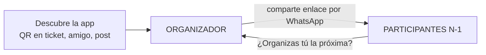
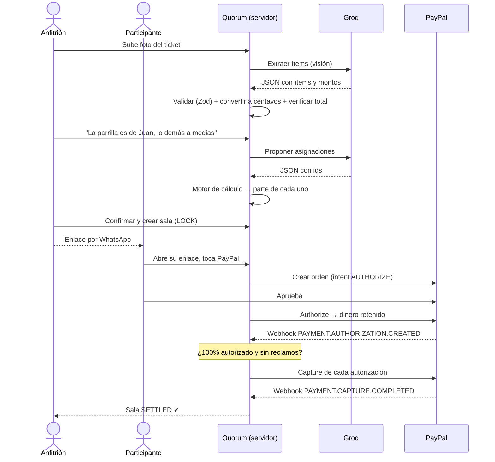

# 02 · Flujo de usuario

## Idea clave

**Solo una persona tiene que descubrir la app: el organizador.** Los demás llegan por el enlace
que él comparte. Cada sala expone la app a N-1 personas nuevas (crecimiento viral).

Hay **dos experiencias distintas**. Sin registro en ninguna.

---

## Recorrido 1 · Organizador (anfitrión)

Contexto: está en la mesa, con la cuenta delante y todos esperando. Paciencia: **~60 segundos**.

| # | Pantalla | Acción | Diseño anti-fricción |
|---|---|---|---|
| 1 | Inicio | Abre la web | La página de inicio **es** la acción: botón "Sube tu ticket". Sin landing, sin login |
| 2 | Captura | Foto del ticket (o audio/texto) | Groq lee el ticket en segundos |
| 3 | Revisión | Ve los ítems detectados | Editables. Si la suma no coincide con el total impreso, se marca en rojo |
| 4 | Personas | Escribe los nombres | Chips rápidos: "Ana", "Carlos"… |
| 5 | Asignación | "La parrilla es de Juan, lo demás a medias" | La IA propone; el organizador toca para corregir |
| 6 | Resumen | Ve cuánto paga cada uno | Tarjetas por persona con desglose. **Aquí entiende el valor de la app** |
| 7 | Sala creada | Comparte enlaces | Un enlace por persona + botón "Compartir por WhatsApp" |
| 8 | Seguimiento | Ve la barra llenarse en vivo | Botón "Recordar"; cuenta regresiva del plazo |
| 9 | Cierre | 100% → cobro automático | Pide el email PayPal del beneficiario **solo ahora** |

## Recorrido 2 · Participante

Contexto: recibió un enlace de un amigo. Primera reacción: **desconfianza**.

| # | Pantalla | Qué ve | Por qué |
|---|---|---|---|
| 1 | Enlace abierto | "Hola Ana 👋 Te tocan **$42.50** de la cena con Juan" | Su nombre y su monto, de inmediato |
| 2 | Desglose | Sus ítems + su parte de impuesto/propina | Transparencia = confianza |
| 3 | ¿No es tuyo? | Botón "Esto no es mío" | Abre el flujo de reclamo con consenso |
| 4 | Pago | Botón oficial de PayPal + "No se te cobra hasta que todos confirmen" | El AUTHORIZE explica la seguridad |
| 5 | Confirmación | Animación + sonido + barra del grupo avanzando | Recompensa emocional (efecto "Yape") |
| 6 | Viral | "¿Organizas tú la próxima?" | Convierte participante en organizador |

## Flujo completo (secuencia)

## Métricas del embudo

Se registran en la tabla `analytics_events` y se ven en el dashboard.

| Evento | Métrica derivada | Meta demo |
|---|---|---|
| `landing_viewed` → `room_created` | Tiempo hasta crear sala | < 60 s |
| `receipt_extracted` vs ediciones | Precisión de la IA | > 90% ítems sin corregir |
| `link_opened` / invitados | Tasa de apertura | — |
| `authorized` / `link_opened` | **Conversión a pago** (la métrica clave) | — |
| `room_created` → `settled` | Tiempo hasta 100% | — |
| participante que luego crea sala | Coeficiente viral | — |
