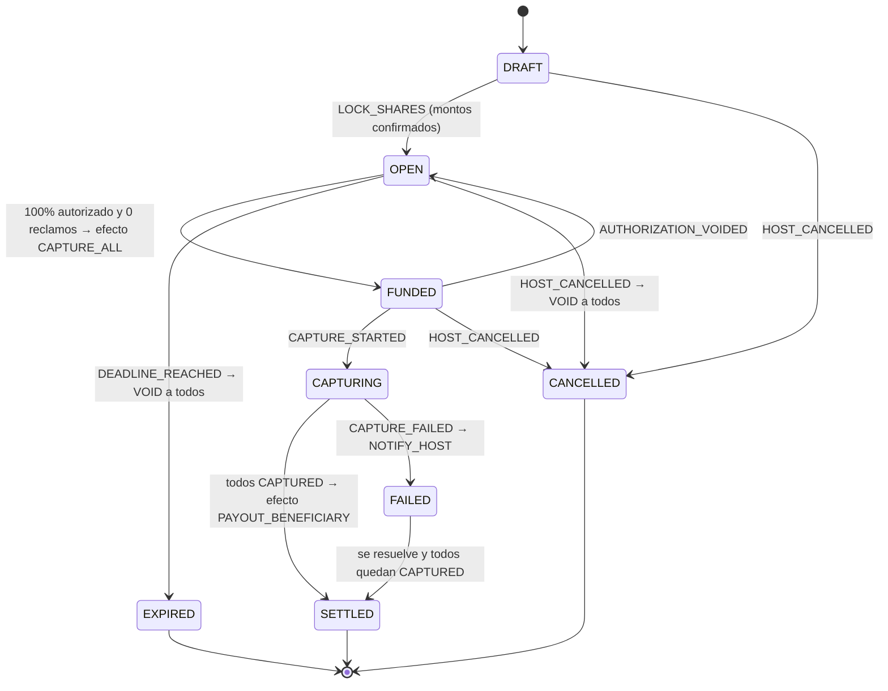
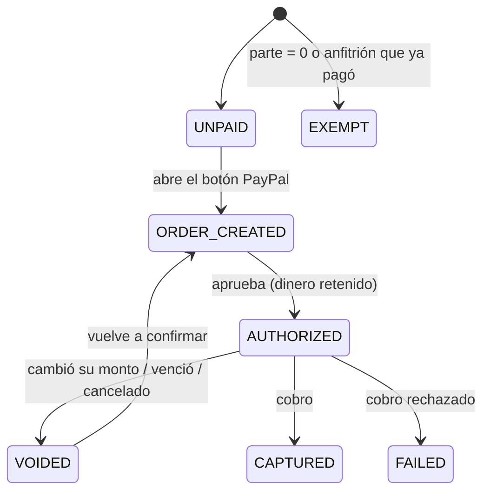
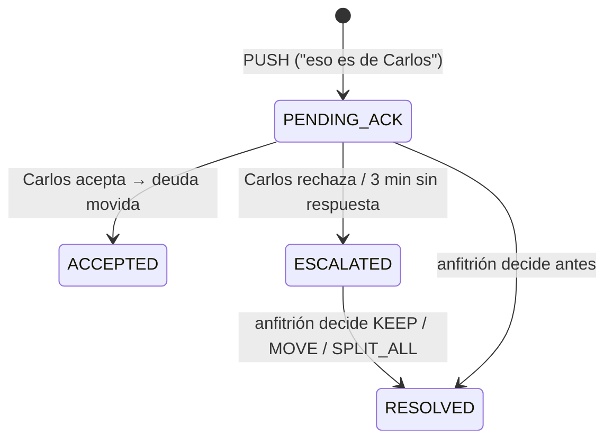

# 05 · Máquinas de estado

Código: `src/core/room-machine.ts`, `src/core/claims.ts`

## Por qué un reducer puro

```ts
reduceRoom(estado, evento) → { estado, efectos }
```

- El **evento** viene del usuario, de un webhook de PayPal o del cron.
- Los **efectos** son órdenes para el servidor: `VOID_AUTHORIZATION`, `CAPTURE_ALL`,
  `PAYOUT_BENEFICIARY`, `NOTIFY_HOST`, `NOTIFY_PARTICIPANT`.
- Una transición inválida lanza `TransitionError`. Ejemplo: cobrar una sala que no llegó al 100%
  es **imposible por código**.

## 1 · Sala



| Estado | Significado | ¿Alguien perdió dinero? |
|---|---|---|
| DRAFT | El anfitrión revisa ítems | No hay dinero en juego |
| OPEN | Enlaces activos, juntando autorizaciones | Dinero retenido, no cobrado |
| FUNDED | 100% autorizado: se dispara el cobro | Retenido |
| CAPTURING | Cobrando | En proceso |
| SETTLED | Todo cobrado ✔ | — |
| EXPIRED / CANCELLED | Se anuló todo | **No**: las retenciones se liberan |
| FAILED | Falló algún cobro | Requiere acción del anfitrión |

## 2 · Pago de cada participante



### Casos límite cubiertos por tests

| Caso | Comportamiento |
|---|---|
| Webhook duplicado (PayPal reintenta) | Idempotente: no cambia nada |
| Alguien autoriza **después** de vencer | Se anula automáticamente, no se cobra |
| Reclamo abierto y todos autorizaron | No se cobra hasta cerrar el reclamo |
| Reclamo cambia el monto de alguien ya autorizado | Se anula su autorización; debe re-confirmar |
| Evento de un participante inexistente o exento | `TransitionError` |
| Cancelar cuando ya se está cobrando | `TransitionError` |

## 3 · Reclamos con consenso



| Tipo | Ejemplo | Regla |
|---|---|---|
| **PULL** | "Yo invito la cerveza de Juan" | Asumo deuda ajena → **se aplica al instante** |
| **PUSH** | "Esa cerveza la pidió Carlos" | Paso mi deuda a otro → **requiere que Carlos acepte** |

Decisiones del anfitrión:

- `KEEP`: se queda con quien la tenía.
- `MOVE`: pasa al destinatario.
- `SPLIT_ALL`: la porción en disputa se reparte entre todos.

Reglas anti-"papa caliente":

- Solo puedes empujar algo **que es tuyo** (no puedes mover la deuda de otro).
- Solo el **destinatario** puede aceptar (Juan no puede auto-aprobar su propio reclamo).
- Máximo **2 PUSH por persona**; después decide el anfitrión.
- No se permiten dos reclamos abiertos sobre el mismo ítem.
- Mientras haya reclamos abiertos, la sala **no se cobra**.
